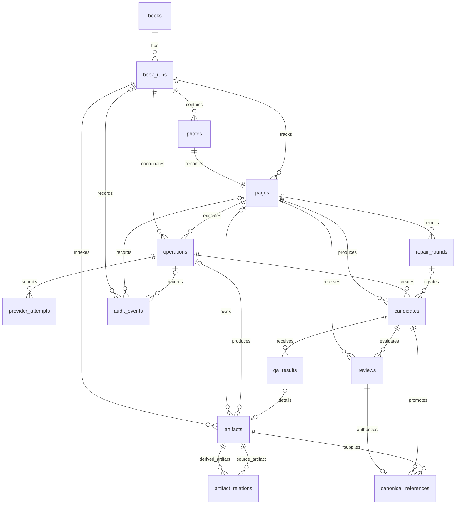
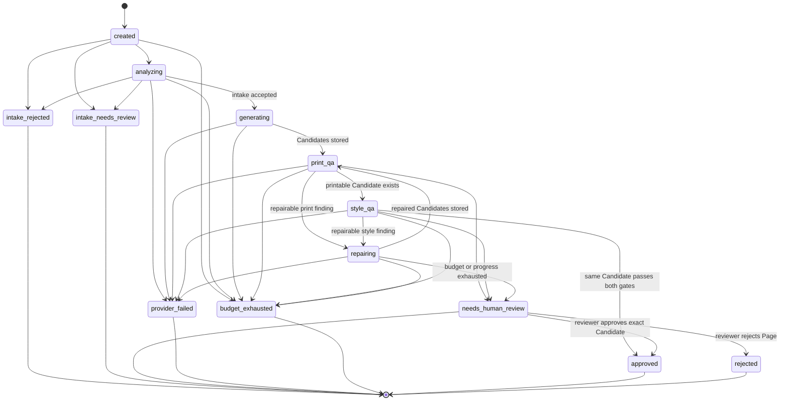
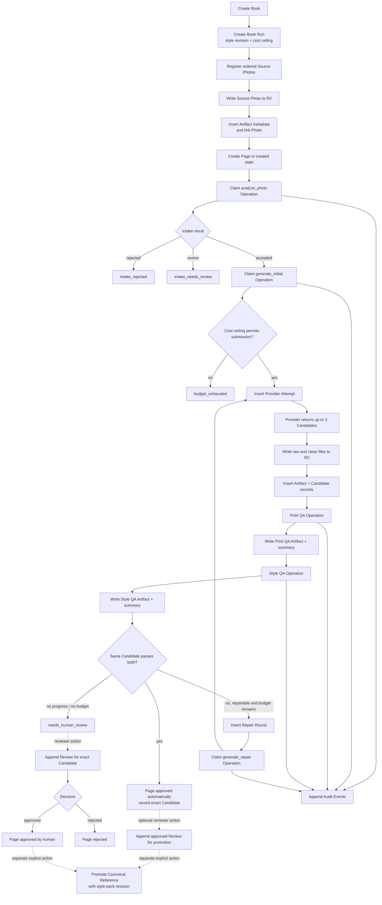

# Pictobook D1 schema

Last updated: 2026-11-10

This document describes the production pipeline schema introduced by
[`0002_pipeline_state.sql`](../apps/pipeline-cloudflare/migrations/0002_pipeline_state.sql).
D1 is authoritative for product and workflow state. R2 is authoritative for
the immutable files described by Artifact records.

WP6 migration
[`0004_authenticated_api.sql`](../apps/pipeline-cloudflare/migrations/0004_authenticated_api.sql)
adds the authenticated API records below without changing the Page state
machine.

## Schema at a glance



The diagram shows domain relationships. Most are enforced by foreign keys.
The current migration retains a few logical artifact references on `photos` and
`candidates` without foreign keys because those records and Artifacts are
created in different stages; WP3 must resolve them transactionally when an R2
write is committed.

## Ownership hierarchy

```text
Book
└── Book Run
    ├── Source Photos
    │   └── Page (one per Source Photo in the current model)
    │       ├── Operations
    │       │   └── Provider Attempts
    │       ├── Candidates
    │       │   ├── Print QA
    │       │   ├── Style QA
    │       │   └── Reviews
    │       └── Repair Rounds
    ├── Artifacts and their provenance
    └── Audit Events

Approved Review
└── optional Canonical Reference promotion
```

## Authenticated API tables

| Table                    | Purpose and relationships                                                                                                                                                 |
| ------------------------ | ------------------------------------------------------------------------------------------------------------------------------------------------------------------------- |
| `api_sessions`           | Stores only SHA-256 bearer-token digests, their user ID, expiry, and optional revocation. It is the authentication seam; ownership remains on `books.owner_id`.           |
| `api_idempotency`        | Claims each user-scoped mutation key, records its operation, and stores the completed HTTP status and JSON response. The same key cannot authorize a different operation. |
| `upload_intents`         | Connects an owner, Book Run, Photo, immutable R2 object key, MIME type, byte size, and SHA-256 digest. A Run starts only after its uploaded object matches this record.   |
| `book_run_regenerations` | Links a new Run to its source Run/Page and stores the immutable JSON snapshot of QA findings and reviewer notes used for source regeneration.                             |

`canonical_style_pack_revision_idx` makes each style-pack revision globally
unique within its style-pack version.

## Table catalogue

### Product and run tables

| Table       | Purpose                                                                       | Important relationships and rules                                                                                                                                                   |
| ----------- | ----------------------------------------------------------------------------- | ----------------------------------------------------------------------------------------------------------------------------------------------------------------------------------- |
| `books`     | The customer-owned coloring book being produced.                              | Parent of one or more Book Runs. `owner_id` is the future authorization boundary.                                                                                                   |
| `book_runs` | One traceable attempt to produce a Book from an ordered set of Source Photos. | Belongs to a Book. Owns the style-pack version and cost ceiling. Actual provider costs accumulate in `cost_spent_micros` and cannot exceed the ceiling.                             |
| `photos`    | The ordered Source Photos accepted into a Book Run.                           | Belongs to a Book Run. `(run_id, ordinal)` preserves page order. `intake_status` separates accepted, rejected, and reviewable inputs.                                               |
| `pages`     | The independently resumable state machine for one Source Photo.               | Belongs to a Photo and Book Run. Stores the current state, terminal reason, exact approved Candidate, approval source, and database-maintained Candidate and Repair Round counters. |

The current schema models one Page for each Source Photo. A future requirement
for multiple pages from one photo would require a deliberate cardinality change,
not an overloaded `ordinal` or Candidate record.

### Execution and budget tables

| Table                        | Purpose                                                                                                                   | Important relationships and rules                                                                                                                                                                                          |
| ---------------------------- | ------------------------------------------------------------------------------------------------------------------------- | -------------------------------------------------------------------------------------------------------------------------------------------------------------------------------------------------------------------------- |
| `book_run_execution_configs` | Snapshots provider, generation model, Style QA model, execution profile, and per-candidate cost estimates for a Run.      | One-to-one with a Book Run. Workflow behavior and cost estimates do not change if deployment settings change after the Run is created.                                                                                     |
| `operations`                 | Durable Operation Claims for side effects such as generation, QA, normalization, export, review, and canonical promotion. | The primary-key Operation ID makes replay idempotent. A completed `outcome_json` is returned instead of repeating the side effect. Semantic attempts are limited to two; Infrastructure Retries are counted separately.    |
| `provider_attempts`          | Each actual provider submission made for an Operation Claim.                                                              | Belongs to an Operation and Book Run. `(operation_id, infrastructure_attempt)` is unique, attempts are limited to 1–3, semantic counters must match the owning Operation, and estimated cost is checked before submission. |
| `repair_rounds`              | One bounded change to the creative instructions following QA findings.                                                    | Belongs to a Page. Only rounds 1 and 2 exist, each requesting no more than two Candidates. Records whether the strategy repairs a Candidate or regenerates from the Source Photo.                                          |

An Infrastructure Retry repeats the same provider operation. A Repair Round
changes the creative instructions. They are deliberately different records and
counters.

### Candidate and QA tables

| Table        | Purpose                                                                     | Important relationships and rules                                                                                                                                                                   |
| ------------ | --------------------------------------------------------------------------- | --------------------------------------------------------------------------------------------------------------------------------------------------------------------------------------------------- |
| `candidates` | Generated coloring-page options for a Page.                                 | Created by exactly one Operation. Initial Candidates have no Repair Round; repaired Candidates must name one. A Page may have at most three initial Candidates and two Candidates per Repair Round. |
| `qa_results` | The summary status and score for one Candidate's Print QA or Style QA gate. | `(candidate_id, qa_kind)` is unique, so each Candidate has at most one current summary per gate. Detailed QA JSON lives in R2 and is referenced through `artifact_id`.                              |

A Page can become automatically `approved` only when one query can find the
same Candidate with both `print = passed` and `style = passed`. Passing results
split across two Candidates do not qualify. Human approval is also possible
from `needs_human_review`, but it requires an append-only approved Review for
that exact Candidate.

### Artifact and provenance tables

| Table                | Purpose                                                               | Important relationships and rules                                                                                                                                         |
| -------------------- | --------------------------------------------------------------------- | ------------------------------------------------------------------------------------------------------------------------------------------------------------------------- |
| `artifacts`          | The D1 index of every durable R2 object needed to recover a Book Run. | Stores the immutable object key, SHA-256, size, MIME type, schema version, producer, retention class, and soft-deletion time. It never stores image bytes or public URLs. |
| `artifact_relations` | A provenance graph between Artifacts.                                 | Records `derived_from`, `judges`, `packages`, and `references` edges. An Artifact cannot relate to itself, and each edge is unique.                                       |

The database is the index: normal application code looks up exact object keys
in `artifacts`; it does not infer state by listing R2 prefixes.
The [WP3 R2 Artifact Adapter](./cloudflare-wp3-r2-artifact-storage.md) implements
that write, verification, recovery, and deletion boundary.

### Human decision and style tables

| Table                  | Purpose                                                                     | Important relationships and rules                                                                                                                                                                |
| ---------------------- | --------------------------------------------------------------------------- | ------------------------------------------------------------------------------------------------------------------------------------------------------------------------------------------------ |
| `reviews`              | Append-only human decisions about an exact Candidate revision.              | Belongs to both Page and Candidate through a composite foreign key. Review rows cannot be updated or deleted. Only one approved review is permitted per Page. Corrections are new review events. |
| `canonical_references` | Explicit promotion of an approved Candidate into the house style catalogue. | Requires an approved Review, exact Candidate and Artifact, promoter identity, style-pack version, and positive revision number. Promotion is separate from approval.                             |
| `audit_events`         | Structured history for operational and reviewer actions.                    | May reference a Book Run, Page, and Operation. Payloads must be valid JSON; actors are system, Workflow, provider, or reviewer.                                                                  |

### Preserved WP0 tables

| Table              | Purpose                           |
| ------------------ | --------------------------------- |
| `spike_sources`    | WP0 validation uploads.           |
| `spike_runs`       | WP0 Container-normalization runs. |
| `spike_operations` | WP0 idempotency records.          |
| `spike_artifacts`  | WP0 normalized-image metadata.    |

These tables are retained only to make the WP0-to-WP2 migration lossless. New
production pipeline features use the canonical tables above.

## Page state machine

Arrow labels distinguish automated pipeline transitions from explicit reviewer
decisions. Any transition not drawn is rejected by D1.



`approved` ends automatic generation and identifies the exact accepted
Candidate. Its `approval_source` is `automatic` when that Candidate passed both
QA gates and `human` when an append-only Review approved an exception. Other
terminal states cannot start automated work; resuming them requires a new
versioned Book Run or an explicitly modeled reviewer command.

## How data flows through the schema



### One generation example

For the first provider call on a Page:

1. The Workflow inserts an `operations` row using a stable Operation ID.
2. A replay that sees that ID reads its status and outcome instead of creating
   another provider charge.
3. Before submission, `provider_attempts` verifies the Book Run cost ceiling,
   retry number, and semantic-attempt number.
4. Generated bytes are written to immutable R2 keys.
5. D1 receives `artifacts` and `candidates` rows only after the write succeeds.
6. Print QA and Style QA each write an immutable R2 result and one `qa_results`
   summary.
7. Automatic `approved` succeeds only if both passing summaries name the same
   Candidate; the Page records that Candidate and `approval_source = automatic`.

## Constraint ownership

| Rule                                          | Enforced by                                                              |
| --------------------------------------------- | ------------------------------------------------------------------------ |
| Every Page starts at `created`                | `pages_initial_state_guard`                                              |
| Allowed Page transitions                      | `pages_state_transition_guard`                                           |
| Same-Candidate automatic approval             | `pages_approved_requires_evidence`                                       |
| Three initial Candidates                      | `candidates_initial_limit` and Page counter constraint                   |
| Two Repair Rounds, two Candidates each        | `repair_rounds` checks and `candidates_repair_round_limit`               |
| Three Infrastructure Retries                  | `provider_attempts.infrastructure_attempt` and uniqueness                |
| Separate semantic and infrastructure counters | `provider_attempts_semantic_counter_match`                               |
| Book Run cost ceiling                         | `provider_attempts_cost_guard` and `book_runs` check                     |
| Operation replay identity                     | `operations.operation_id` primary key                                    |
| No automatic work from terminal states        | `operations_terminal_page_guard`                                         |
| Append-only exact-Candidate approval          | review triggers, composite foreign key, and partial unique index         |
| Explicit revisioned Canonical promotion       | `canonical_requires_approved_review` and Canonical Reference constraints |

## Source files

- Schema migration: [`apps/pipeline-cloudflare/migrations/0002_pipeline_state.sql`](../apps/pipeline-cloudflare/migrations/0002_pipeline_state.sql)
- Typed records: [`apps/pipeline-cloudflare/src/domain/records.ts`](../apps/pipeline-cloudflare/src/domain/records.ts)
- R2 object keys: [`apps/pipeline-cloudflare/src/domain/objectKeys.ts`](../apps/pipeline-cloudflare/src/domain/objectKeys.ts)
- Invariant tests: [`apps/pipeline-cloudflare/scripts/wp2-migrations.test.mjs`](../apps/pipeline-cloudflare/scripts/wp2-migrations.test.mjs)
- Architecture decision: [`docs/adr/0001-bounded-durable-pipeline-jobs.md`](adr/0001-bounded-durable-pipeline-jobs.md)
