# Customer API contract

This document maps the customer React screens to the HTTP API they need. The
OpenAPI file at [`customer-api.openapi.yaml`](./customer-api.openapi.yaml) is
the machine-readable target contract. The pipeline Worker already implements
the generation and review core, but several customer-product operations and the
Clerk authentication integration still need implementation.

## Documentation standard

Use OpenAPI as the API contract: it describes paths, methods, authentication,
request and response schemas, and errors in a language-neutral format. Keep
human workflow guidance here, and keep the detailed endpoint contract in YAML.
OpenAPI 3.1.1 is selected for broad tooling support; the current specification
also has a 3.2.1 release. See the [OpenAPI specification](https://spec.openapis.org/oas/).

The OpenAPI document describes the **target customer contract**, not a claim
that every operation already exists. Implementation status is shown below.
When code is updated, the spec and implementation must be changed together.
For screen/component ownership and planned React Query hook names, see the
[agent-readable screen API map](./customer-screen-api-map.yaml).

## Screen-to-API map

| React screen/state            | Data needed or customer action                                   | API operation                                                                            | Status                                                               |
| ----------------------------- | ---------------------------------------------------------------- | ---------------------------------------------------------------------------------------- | -------------------------------------------------------------------- |
| Welcome / First visit         | Explain the product; no customer data                            | None                                                                                     | Local content                                                        |
| Sign in / Check email         | Google sign-in or email magic link                               | Clerk React SDK; Worker verifies Clerk session JWT                                       | Planned; current Worker uses opaque D1 bearer sessions               |
| My books                      | List owned books, progress, latest page states, order status     | `GET /v1/books`                                                                          | Partial; current response is a thin book list without page summaries |
| Book details                  | Create a draft with child name, age, and title; edit it          | `POST /v1/books`, `PATCH /v1/books/{bookId}`                                             | Partial; create currently stores only a draft book ID                |
| Photo selection               | Create the draft run's upload intents and upload selected photos | `POST /v1/books/{bookId}/runs`; local browser `PUT`s to the authenticated Worker         | Local path implemented; UI is not connected                          |
| Arrange pages                 | Persist the chosen page order before starting generation         | `PATCH /v1/books/{bookId}/runs/{runId}/photo-order`                                      | Implemented; UI is not connected                                     |
| Processing / Slow processing  | Read run/page status and progress                                | `POST /v1/books/{bookId}/runs/{runId}/start`; poll `GET /v1/books/{bookId}/runs/{runId}` | Implemented; UI is not connected                                     |
| Page review / Needs attention | Read candidate previews and QA; approve/reject/request changes   | `GET` run; `POST /v1/books/{bookId}/pages/{pageId}/reviews`; `POST .../regenerations`    | Implemented; UI is not connected                                     |
| Book preview                  | Read approved pages and obtain private preview/download access   | `GET` run; `GET /v1/artifacts/{artifactId}/access`                                       | Implemented; book export workflow/format is incomplete               |
| Edition selection             | Show available formats, current price, and delivery terms        | `GET /v1/catalog/editions`                                                               | Local prototype entries are unavailable and have zero prices         |
| Checkout                      | Create order and payment session                                 | `POST /v1/books/{bookId}/orders`                                                         | Gap; payment provider and fulfillment integration are not selected   |
| Order received / Status       | Show order state, tracking, or PDF download                      | `GET /v1/orders/{orderId}`                                                               | Gap                                                                  |
| Upload/generation error       | Show actionable error and allow safe retry                       | `GET` run, `POST .../upload-intents/{id}/refresh`, or `POST .../regenerations`           | Local refresh implemented; UI integration remains                    |

## Journey map

```mermaid
flowchart LR
  L["My books<br/>BookshelfScreen"] -->|createBook| D["Book details<br/>BookDetailsScreen"]
  D -->|createBook or updateBook| P["Choose photos<br/>PhotoSelectionScreen"]
  P -->|createBookRun + authenticated local Worker upload| O["Order pages<br/>OrderPagesScreen"]
  O -->|updatePhotoOrder, then startBookRun| G["Processing<br/>ProcessingScreen"]
  G -->|poll getBookRun| R["Review page<br/>PageReviewScreen"]
  G -->|slow page state| S["Slow processing<br/>SlowProcessingScreen"]
  S -->|poll getBookRun| G
  R -->|reviewCandidate| V["Book preview<br/>BookPreviewScreen"]
  R -->|reviewCandidate: changes requested| I["Needs attention<br/>PageReviewScreen"]
  I -->|regeneratePage with judge notes| G
  V -->|listEditions| E["Choose edition<br/>EditionSelectionScreen"]
  E -->|createOrder| C["Checkout<br/>CheckoutScreen"]
  C -->|verified payment, then getOrder| F["Order received<br/>OrderCompleteScreen"]
```

The machine-readable map expands every state with its route, React screen
component, planned query/mutation hook, operation ID, and wiring status. The
OpenAPI document also carries the higher-level journey sequence so the routes
remain discoverable in Swagger UI.

Clerk owns sign-in, email-link delivery, session refresh, and provider account
linking. The Worker must verify the Clerk-issued token and resolve its stable
subject to an internal user ID before applying existing book ownership checks.
Do not treat an email address as the owner key. No password, magic-link secret,
or Clerk secret key belongs in the browser or D1.

## API behavior rules

- JSON request/response fields use `camelCase`; SQL column names stay internal.
- All customer resources are owner-scoped. IDs from the browser never grant
  access on their own.
- Every mutating customer operation sends an `Idempotency-Key` header. This is
  especially important for creating runs, reviews, regenerations, orders, and
  payment sessions.
- Photo selection creates the unstarted run and upload intents. In local mode,
  the browser sends each photo to the authenticated Worker, which writes only
  through the local R2 binding. The arrange screen persists the final order
  through the photo-order operation. Only then does the customer start
  generation.
- The Worker creates a run and returns short-lived upload URLs. The local
  upload route verifies owner, intent, content type, size, and SHA-256 before
  writing. Non-local environments can keep using scoped R2 upload URLs.
- Run creation/start returns quickly. Generation is asynchronous. The client
  reads status with TanStack Query and polls only while the run is active; stop
  polling on a terminal state. Workflow execution, not a request timeout,
  controls retries and bounded auto-repair.
- A review names the exact candidate revision. It never means “approve the
  latest candidate” implicitly.
- Artifact access is private and temporary. The API authorizes the owner before
  issuing a short-lived download URL.
- Checkout must be idempotent and provider-neutral at the customer API. The
  server creates the payment session; payment completion is accepted only from
  a verified provider webhook, never from a browser redirect.
- Use `application/problem+json` for errors, with stable machine-readable
  `code` values. Never return stack traces, provider secrets, or raw database
  errors to the customer.

The current Worker uses a smaller `{ "error": "stable_code" }` response. The
target contract standardizes errors as Problem Details; implementation should
make that response-shape change alongside generated-client adoption.

## Implementation sequence

1. Add Clerk to the React app and Worker authentication boundary; map Clerk
   subjects to stable internal user IDs.
2. Expand Book fields and implement draft persistence; connect the bookshelf
   and book-details screens.
3. Connect photo upload, ordering, run start, status polling, review, and
   regeneration to the existing pipeline routes.
4. Add edition catalog, order creation, payment provider, verified payment
   webhook, and order status after choosing payment/print providers.
5. Generate the TypeScript client types from OpenAPI and add contract checks so
   implementation and spec cannot drift.
