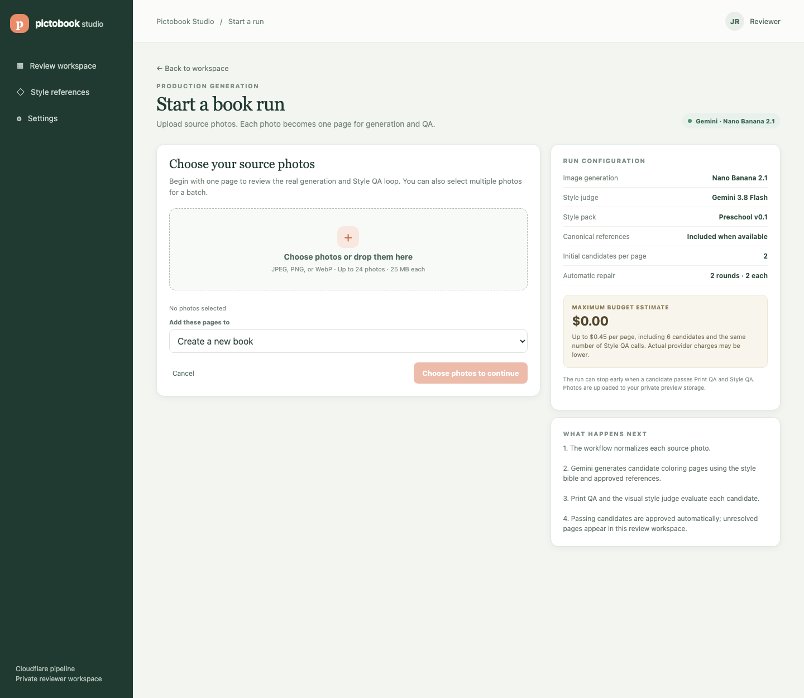

# Start a run

The local Cloudflare reviewer dashboard now has a run launch screen for uploading
source photos and starting a generation and QA workflow.



## Review locally

Start the preview dashboard from the repository root:

```sh
pnpm --filter pipeline dashboard:cloudflare:preview
```

Open `http://127.0.0.1:4180`, select **Start a run**, choose one or more JPEG,
PNG, or WebP photos, then click **Generate**. The screen shows the configured
Nano Banana 2.1 generator, Gemini 3.8 Flash style judge, active style pack, and
the maximum estimated budget before the run begins. The preview dashboard uses
the Cloudflare preview Worker, D1 database, and R2 bucket configured in
`apps/pipeline-cloudflare/.env.preview`.

The global pipeline setting starts two candidates per page. If neither passes,
the workflow allows two repair rounds with two candidates each, for at most six
candidates and a $0.45 estimate per page at the current provider cost settings.
The active count and estimate come from the Worker configuration and are saved
with each new run.

## Flow

1. Choose a new book or add pages to an existing book.
2. The dashboard hashes each photo and asks the API for a run and signed upload
   links.
3. The browser sends photo bytes through the loopback dashboard proxy. The
   proxy forwards them to the signed R2 upload URL, keeping provider credentials
   out of the browser.
4. After all uploads succeed, the dashboard starts the workflow. Print QA,
   Style QA, automatic repair, and automatic approval run through the pipeline.
5. The dashboard opens the run so page progress and candidates can be reviewed.

Uploads run sequentially. If an upload fails, Retry resumes at the first photo
that did not upload. Expired links trigger a fresh run record and new links when
Retry is selected. Idempotency keys keep retried create and start requests from
starting duplicate generations.

The current interface is a private operator/reviewer tool. It does not provide
customer sign-in, book naming, payment, or an end-user account experience; those
belong to the customer app frontend.

## Screenshot

- Viewport: 1440 × 1250 pixels
- Route: `/?story=new-run` (synthetic book list, no preview API calls)
- Browser: Google Chrome headless
- Date: 2026-11-10
- Synthetic configuration: two initial candidates, two repair rounds of two,
  six maximum candidates, $0.45 maximum estimated per page
